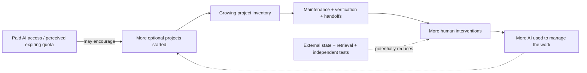

# 🧠 The AI Productivity Trap

### When AI makes creation easy, who maintains everything we create?

**Open research note · v0.1 · October 17, 2026 · Independent practitioner case · Not peer reviewed**

**[Read the full paper →](PAPER.md)** · **[Measures & methodology →](METHODS_AND_METRICS.md)** · **[Citation →](CITATION.md)**

> AI can make a new project easy to start. But what if the projects we create require more AI to maintain — and more human time to supervise the AI?

This independent, exploratory note proposes a feedback loop:

**The key distinction:** This is a **testable conceptual framework**, not a claim that every AI user experiences it, that frequent AI use is harmful, or that paid quotas have already been shown to cause new projects.

### 💬 Where the idea comes from

A practitioner noticed that their personal use of AI changed as she moved from occasional questions to building multiple websites, automations, and reusable agent instructions. Lower creation costs created more things to maintain. Across conversations, agents occasionally failed to retrieve current decisions, required prompts to continue, or needed the human to verify that an action really succeeded.

The paper uses **anonymized first-person observations**, discloses their limitations, and proposes measurable tests. Project names, personal details, employers, counterparties, and private logs are intentionally omitted. The research insight and original case observations are the practitioner's; AI assisted with drafting and source review.

### 🔍 What readers can reuse

- A five-stage model of quota salience, new-project formation, maintenance stock, continuity gaps, and growing supervision.
- A taxonomy distinguishing **access**, **retrieval**, **compaction**, **state synchronization**, **changing requirements**, and **verification** failures.
- Five falsifiable hypotheses and metrics that distinguish **human effort saved** from **human effort displaced**.
- A privacy-first blank [measurement template](metrics-template.csv).
- A bounded-autonomy maintenance protocol: **observe → classify → patch → independently test → verify → roll back if necessary**.

### ❌ What this is not

Not a peer-reviewed journal article; not population-level data; not a clinical theory of dependency; not a measured causal effect of one vendor or subscription plan; not a guarantee that autonomous maintenance reduces costs.

### 📚 Related research

The note connects published work on [prepaid digital-service incentives](https://doi.org/10.1177/10591478261454768), [AI work intensification](https://hbr.org/2026/02/ai-doesnt-reduce-work-it-intensifies-it), [real-world AI coding overhead](https://survey.stackoverflow.co/2025/ai), [context engineering](https://www.anthropic.com/engineering/effective-context-engineering-for-ai-agents), and [multi-session agent memory](https://proceedings.mlr.press/v306/he26am.html). See the full [reference list](PAPER.md#references).

### 🛠️ An open research conversation

Questions and corrections are welcome. If you've experienced a similar pattern, share **anonymized** observations, especially counterexamples where agents genuinely reduced long-term human work. Never post private chat transcripts, account IDs, credentials, employer materials, or someone else's personal information.

**Research record / DOI:** Not yet registered. A standalone Zenodo research deposit is planned. GitHub publication does **not** mean a DOI has already been issued.

**License:** [CC BY 4.0 for the research text](LICENSE.md), with attribution to the repository maintainer under the public authorship label. See [citation](CITATION.md).

**Version:** v0.1. Subsequent claims and data will be versioned rather than silently rewriting the original account.